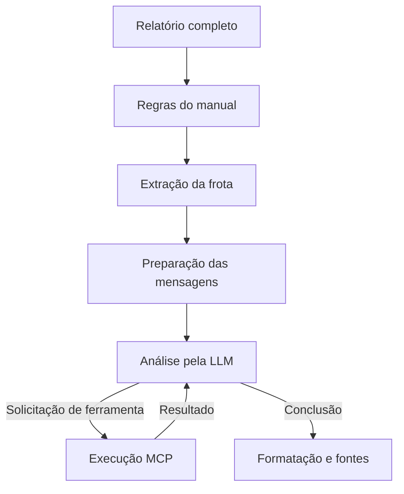

# Frota Agentic

Análise documental da frota com RAG híbrido, ferramentas descobertas via MCP e observabilidade com Langfuse.

O Frota Agentic combina as regras do Manual de Operações do Porto Alfa com a situação descrita no relatório da frota. A aplicação recupera as evidências, extrai os navios e disponibiliza à LLM o catálogo de um servidor MCP para verificar reservas, determinar velocidades e calcular tempos de viagem.

O projeto é desenvolvido no repositório `Agent_frotas`, a partir do template do exercício anterior, `Frotas_manual`. Os documentos são fictícios e didáticos.

## O problema

Para responder “Qual navio chega primeiro ao porto?”, é necessário saber quais navios podem zarpar e qual velocidade cada um pode usar. Uma divisão correta pode produzir uma conclusão inadequada se incluir um navio bloqueado por falta de combustível ou ignorar a tempestade.

| Fonte | Informação fornecida |
|---|---|
| `manual_operacoes.txt` | Regras de velocidade, reserva e cálculo do ETA. |
| `relatorio_frota.txt` | Distância, velocidade planejada, combustível, reserva, destino e tempestade de cada navio. |
| Ferramentas MCP | Verificações e cálculos sobre os valores recuperados. |

As ferramentas desta etapa produzem estimativas e verificações. O relatório representa a situação antes da partida.

## Evolução do exercício

| Componente | Base do exercício anterior | Implementação deste repositório |
|---|---|---|
| Documentos | Manual operacional | Manual e relatório da frota. |
| Recuperação | BM25 e busca semântica combinadas por RRF | Busca híbrida dentro da origem selecionada e leitura completa do relatório. |
| Dados | Trechos documentais | Extração estruturada dos navios com Pydantic. |
| Cobertura | Trechos relevantes para uma pergunta | Conferência dos identificadores do relatório e da extração. |
| Análise | Resposta documental | LLM seleciona ferramentas descobertas dinamicamente no MCP. |
| Execução | Geração de resposta | Ciclo de solicitações, resultados de ferramentas e conclusão. |
| Inspeção | Fontes e contexto final | Callbacks Langfuse para acompanhar etapas, argumentos e retornos. |

O índice semântico é reconstruído a cada busca híbrida. A reutilização de embeddings permanece como uma melhoria possível.

## Fluxo implementado



| Nó | Responsabilidade | Atualização do estado |
|---|---|---|
| `retrieve_frota` | Carrega todas as seções do relatório e identifica os navios esperados. | `documentos`, `contextos`, `ids_relatorio` e `fontes`. |
| `retrieve_regras_calculo` | Recupera quatro trechos do manual sobre tempestade, reserva e ETA. | `contexto_regras`, `contextos_regras` e `fontes`. |
| `extract_frota` | Converte o relatório em navios estruturados e confere seus identificadores. | `frota`. |
| `prepare` | Junta pergunta, frota e regras nas mensagens de análise. | `messages`. |
| `analyze` | Descobre o catálogo MCP e permite ao modelo solicitar ferramentas ou concluir. | Nova mensagem do modelo. |
| `tools` | Localiza cada ferramenta pelo nome solicitado e encaminha a chamada ao MCP. | Mensagens com os resultados e identificadores das chamadas. |
| `format_frota` | Disponibiliza a conclusão e as fontes consultadas. | `resposta` e `resultado`. |

`messages` usa `add_messages` para acumular o histórico. `fontes` usa `operator.add` para acumular as contribuições das recuperações. A apresentação remove repetições das referências.

## Ferramentas descobertas no MCP

O cliente conhece o endereço do servidor e consulta seu catálogo. Nomes, descrições e parâmetros são disponibilizados à LLM por `bind_tools`. A seleção resulta em uma chamada com nome, argumentos e identificador. O executor devolve uma `ToolMessage` ligada à solicitação original.

| Ferramenta | Entrada | Resultado |
|---|---|---|
| `reserva_ok` | Combustível e reserva, em toneladas. | Se o combustível atende à reserva mínima. |
| `velocidade_efetiva` | Velocidade planejada, presença de tempestade e limite recuperado do manual. | Velocidade utilizada na estimativa. |
| `calcular_eta_horas` | Distância em milhas náuticas e velocidade efetiva em nós. | ETA em horas, arredondado a duas casas. |

O limite de tempestade é um argumento da ferramenta. O modelo deve obtê-lo do manual, conforme a rota informada no relatório. O servidor valida o domínio numérico das entradas.

## Resultado esperado com os documentos fornecidos

| Navio | Condição considerada | ETA esperado |
|---|---|---|
| S1-FAROL | 30 t a bordo para reserva de 33 t. Bloqueado. | Excluído dos elegíveis. |
| S2-MARE | Tempestade na rota direta, velocidade limitada a 12 nós. | 63,33 h. |
| S3-CORAL | Reserva atendida e velocidade planejada de 12 nós. | **56,67 h, menor ETA.** |
| S4-ATLAS | Tempestade na rota direta, velocidade limitada a 12 nós. | 68,33 h. |

A conferência de cobertura detecta identificadores ausentes, repetidos ou extras após a extração. A fidelidade dos valores numéricos deve ser conferida com o relatório e os traces.

## Situação da entrega

O `builder.py` publicado executa o caminho de frota. O classificador está implementado, e sua ligação aos caminhos `regra`, `frota` e `fora_escopo` faz parte da próxima etapa.

Os arquivos dos nós de regras e de encerramento e `scripts/avaliar.py` ainda estão vazios. A avaliação das nove perguntas, os scores no Langfuse e a comparação de tokens serão concluídos nessa etapa.

A interface Streamlit foi herdada do Low-Ship e ainda chama `graph.invoke`. O grafo atual contém nós assíncronos e deve ser executado com `graph.ainvoke`. A adaptação visual e assíncrona está especificada em [design.md](src/utils/design.md). O comando do Streamlit abaixo inicia a interface existente, cuja integração com este grafo permanece pendente.

## Preparação do ambiente

Execute os comandos na raiz de `Agent_frotas`, usando Python 3.11 ou superior compatível com as dependências.

```powershell
python -m venv .venv
.\.venv\Scripts\Activate.ps1
python -m pip install -r requirements.txt
python -m nltk.downloader punkt_tab
```

No Linux ou macOS, crie o ambiente com `python3 -m venv .venv` e ative com `source .venv/bin/activate`. O NLTK é instalado pelo requirements. `punkt_tab` fornece os dados adicionais da tokenização lexical em português.

Crie `src/.env` e preencha suas credenciais localmente.

```dotenv
API_KEY=sua_chave_do_openrouter
LLM_MODEL=openai/gpt-4o-mini
MCP_SERVER_URL=http://127.0.0.1:8000/mcp
LANGFUSE_PUBLIC_KEY=pk-lf-sua_chave
LANGFUSE_SECRET_KEY=sk-lf-sua_chave
LANGFUSE_BASE_URL=https://cloud.langfuse.com
```

Use a URL correspondente à região do projeto Langfuse. O modelo de embeddings está configurado como `openai/text-embedding-3-small` via OpenRouter. O arquivo `.env` deve ficar fora do versionamento.

## Executar o fluxo atual

Em um terminal com o ambiente ativo, inicie o servidor MCP a partir da raiz.

```powershell
python src/mcp-server/mcp_server.py
```

Mantenha esse terminal aberto. Em outro terminal, ative o mesmo ambiente e execute a partir de `src`.

```powershell
cd src
python -m utils.mcp_client
```

Esse comando mostra o catálogo descoberto. Para executar uma pergunta completa com rastreamento, use no PowerShell, ainda em `src`.

```powershell
@'
import asyncio

from graph.builder import graph
from utils.langfuse_client import flush, run_config


async def main():
    try:
        resposta = await graph.ainvoke(
            {"pergunta": "Qual navio chega primeiro ao porto?"},
            config=run_config(run_name="chegada-frota", tags=["agent-frotas"]),
        )
        print(resposta["resultado"])
    finally:
        flush()


asyncio.run(main())
'@ | python -
```

### Interface Streamlit

Na raiz, com o ambiente ativo.

```powershell
python -m streamlit run src/app/main.py
```

A adaptação da interface está pendente, conforme descrito na situação da entrega. O novo nome visual será **Frota Agentic**, com a logo de `src/utils/logo.jpeg`, as imagens `navio_1` a `navio_3` e as transições do navio. A especificação está em [design.md](src/utils/design.md).

## Rastreabilidade e observabilidade

`utils/langfuse_client.py` fornece o handler usado em `run_config()`. O grafo registra os retornos dos nós e as chamadas instrumentadas ao modelo e às ferramentas. `flush()` aguarda o envio dos registros pendentes ao encerrar o script.

Para inspecionar o S2-MARE, confira o relatório com 16 nós planejados, o limite de 12 nós recuperado do manual, os argumentos da ferramenta de velocidade e a chamada de ETA com 760 e 12. O resultado esperado é 63,33 h.

As fontes representam os trechos disponibilizados ao processamento. O estado atual não associa automaticamente cada afirmação final a uma evidência individual. A telemetria instrumentada é enviada ao projeto Langfuse configurado.

## Arquivos principais

| Local | Responsabilidade |
|---|---|
| `src/dados/` | Manual, relatório e gabarito de avaliação. |
| `src/graph/state.py` | Campos compartilhados e regras de acumulação. |
| `src/graph/builder.py` | Sequência dos nós e ciclo de ferramentas. |
| `src/graph/node/` | Recuperação, extração, preparação, análise e formatação. |
| `src/graph/prompts/` | Instruções de classificação, extração e análise. |
| `src/utils/vector_store.py` | Preparação dos trechos, embeddings, BM25 e RRF. |
| `src/utils/mcp_client.py` | Descoberta dinâmica das ferramentas. |
| `src/mcp-server/mcp_server.py` | Servidor das ferramentas operacionais. |
| `src/utils/langfuse_client.py` | Configuração dos callbacks e envio dos registros. |
| `src/app/` | Interface Streamlit herdada e recursos de transição. |
| `src/utils/design.md` | Especificação da interface Frota Agentic. |
| `src/scripts/avaliar.py` | Entrada reservada à avaliação com scores. |

## Referências

* [Enunciado do exercício 2](https://github.com/Theteu1/Semana-3-Bootcamp/blob/main/exercicio-2-completo.md)
* [Integração MCP do LangChain](https://docs.langchain.com/oss/python/langchain/mcp)
* [Servidor FastMCP](https://gofastmcp.com/deployment/running-server)
* [Langfuse com LangChain e LangGraph](https://langfuse.com/integrations/frameworks/langchain)
* [Scores via SDK](https://langfuse.com/docs/evaluation/evaluation-methods/scores-via-sdk)
