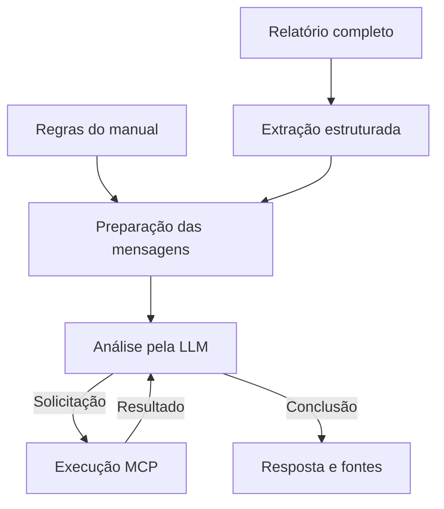

# Agent_frotas — Regras e explicações da etapa 1

## 1. Como usar este material

Este guia explica a implementação construída nesta conversa. A referência é o código enviado para você copiar, incluindo a substituição do executor de ferramentas após o erro do ToolNode. Seus arquivos locais podem conter ajustes adicionais. A leitura deste documento não representa uma auditoria da cópia no seu computador.

Leia primeiro as seções 2 a 5 para entender o problema e o percurso dos dados. Depois acompanhe cada arquivo na ordem apresentada. Os exemplos explicam os blocos, seus argumentos, seus retornos e a função que exercem no fluxo.

Uma resposta “ok” na conversa foi tratada como autorização para continuar. As saídas efetivamente apresentadas comprovam a descoberta das três ferramentas e o ciclo de reserva com chamada MCP real. O resultado da pergunta completa de chegada e a presença do trace no painel precisam ser confirmados na retomada, caso você ainda não tenha feito essa conferência.

## 2. Problema que o sistema resolve

O operador quer responder perguntas sobre regras de navegação e sobre a situação da frota. Para decidir qual navio chega primeiro, precisa combinar três capacidades.

1. Recuperar a situação de todos os navios no relatório.
2. Recuperar as regras aplicáveis no manual.
3. Executar verificações e cálculos usando ferramentas.

O relatório fornece distância, velocidade planejada, combustível, reserva, destino e presença de tempestade. O manual fornece a fórmula do ETA, os limites de tempestade e a regra de impedimento por reserva insuficiente.

A pergunta de chegada exige verificar quem pode participar da comparação. O S1-FAROL teria 50 horas pela conta 700 / 14, porém está com 30 t de combustível para uma reserva de 33 t. Portanto, precisa ser identificado como bloqueado antes da comparação dos elegíveis.

| Navio | Combustível / reserva | Velocidade para a estimativa | ETA esperado |
|---|---|---|---|
| S1-FAROL | 30 / 33 t | Bloqueado pela reserva | Excluído da comparação de elegíveis |
| S2-MARE | 100 / 42 t | 12 nós em tempestade na rota direta | 63,33 h |
| S3-CORAL | 115 / 51 t | 12 nós planejados | 56,67 h |
| S4-ATLAS | 145 / 60 t | 12 nós em tempestade na rota direta | 68,33 h |

O resultado esperado é S3-CORAL. O exercício estima a viagem a partir da fotografia do relatório. As ferramentas implementadas calculam e verificam valores. Elas não enviam comandos operacionais aos navios.

## 3. Decisões aprovadas

* Usar um repositório independente chamado Agent_frotas, iniciado com os arquivos do Frotas_manual.
* Preservar a busca híbrida para recuperar regras.
* Carregar o relatório completo e conferir a cobertura após a extração.
* Publicar as ferramentas em um servidor MCP.
* Descobrir o catálogo completo e disponibilizá-lo à LLM.
* Permitir que o modelo escolha ferramentas pelas descrições e pelos esquemas dos argumentos.
* Acompanhar documentos, argumentos e retornos no Langfuse.
* Implementar depois avaliar.py com score por pergunta no Langfuse.

O cliente conhece o endereço do servidor. Os nomes das ferramentas são descobertos durante a execução. Isso atende à premissa de catálogo desconhecido previamente.

## 4. Percurso completo dos dados



A ordem real do builder nesta etapa é retrieve_frota, retrieve_regras_calculo, extract_frota, prepare e analyze. Após analyze, o grafo decide entre tools e format_frota. As chamadas e resultados são acumulados em messages.

A classificação foi preparada separadamente. O builder atual ainda começa diretamente no caminho de frota. Acrescentaremos o roteamento entre regra, frota e fora_escopo na etapa seguinte.

## 5. Conceitos necessários para acompanhar o código

### Estado e atualização parcial

O estado é o dicionário compartilhado pelos nós do LangGraph. Um nó recebe os dados disponíveis e devolve os campos que deseja atualizar. Retornar {"frota": ...} atualiza a frota e preserva os outros campos do grafo.

Quando as funções são chamadas diretamente em um script, essa combinação não acontece automaticamente. Nos primeiros exemplos, usamos extend para acrescentar mensagens manualmente. Dentro do grafo, os reducers fazem essa combinação.

### LLM, chamada de ferramenta e resultado

Uma AIMessage é uma mensagem produzida pelo modelo. Ela pode conter texto, solicitações em tool_calls ou ambos. Uma ToolMessage registra o resultado de uma operação e carrega o identificador da chamada atendida.

O modelo solicita a operação. O cliente executa a comunicação MCP. O servidor calcula e responde. A LLM recebe a resposta e continua.

### async, await e asyncio.run

async def declara uma função assíncrona. Chamá-la produz uma corrotina, cuja execução precisa ser conduzida por await ou por um agendador.

await aguarda uma operação assíncrona e permite que o agendador conduza outras tarefas enquanto há espera. O processamento assíncrono é útil nas comunicações com o modelo e o MCP.

asyncio.run(main()) cria um event loop, conduz main até o fim e encerra o loop. É usado na entrada do programa. Uma função assíncrona que já está rodando nesse contexto chama outra com await.

### Anotações de tipo

As anotações descrevem os tipos esperados. Elas ajudam o editor e ferramentas de análise. Sozinhas, anotações em funções comuns e TypedDict não validam todos os valores em tempo de execução.

Pydantic valida os modelos estruturados. FastMCP usa as assinaturas para publicar os esquemas das ferramentas e processar as entradas. Ainda precisamos das validações de domínio dentro das funções.

## 6. Inventário dos arquivos

| Arquivo | Situação na etapa 1 | Responsabilidade |
|---|---|---|
| src/graph/state.py | Alterado | Contrato dos dados e reducers |
| src/utils/llm_adapter.py | Criado e preenchido | Modelo configurado para OpenRouter |
| src/graph/prompts/classify_prompt.py | Criado e preenchido | Critério das três intenções |
| src/graph/node/classify.py | Criado e preenchido | Classificação estruturada |
| src/mcp-server/mcp_server.py | Preenchido | Servidor com três ferramentas |
| src/utils/mcp_client.py | Criado e preenchido | Descoberta do catálogo MCP |
| src/graph/node/analyze.py | Criado e preenchido | Chamada à LLM com ferramentas disponíveis |
| src/graph/node/tools.py | Criado e preenchido | Execução das solicitações por nome |
| src/utils/vector_store.py | Alterado | Leitura parametrizada e busca por origem |
| src/graph/node/retrieve_frota.py | Criado e preenchido | Leitura completa do relatório |
| src/graph/prompts/extract_prompt.py | Criado e preenchido | Instruções de extração fiel |
| src/graph/node/extract_frota.py | Criado e preenchido | Extração e conferência dos identificadores |
| src/graph/node/retrieve_regras_calculo.py | Criado e preenchido | Recuperação das regras de cálculo |
| src/graph/prompts/analyze_prompt.py | Criado e preenchido | Instruções da análise operacional |
| src/graph/node/prepare.py | Criado e preenchido | Montagem das mensagens |
| src/graph/node/format_frota.py | Criado e preenchido | Conclusão e fontes para apresentação |
| src/graph/builder.py | Substituído | Grafo do caminho de frota |
| src/utils/langfuse_client.py | Criado e preenchido | Callbacks e envio dos registros |
| requirements.txt | Alterado | Dependências adicionais |
| src/.env | Configuração local | Chaves e endereços |
| .gitignore da raiz | Preenchimento orientado | Ignora credenciais e ambientes |
| src/dados/relatorio_frota.txt | Baixado | Situação dos quatro navios |
| src/dados/avaliacao.json | Baixado | Nove perguntas do gabarito |

Os arquivos retrieve_regras.py, grade.py, generate.py, format_output.py, nao_encontrado.py, refuse.py, grade_prompt.py, graph/routing.py e scripts/avaliar.py foram previstos e tiveram sua criação vazia orientada. O conteúdo deles ainda será desenvolvido. Os nós antigos entrada.py, busca.py, verificacao.py, decisao.py, expansao.py e resposta.py continuam como arquivos herdados, mas saíram do builder substituído nesta etapa.

## 7. src/graph/state.py

Mantivemos RAGState como nome para compatibilidade com o template. Os campos antigos podem continuar presentes. Os acréscimos são estes.

```python
import operator
from typing import Annotated, Literal

from langchain_core.messages import AnyMessage
from langgraph.graph.message import add_messages

# Dentro de RAGState
intent: Literal["regra", "frota", "fora_escopo"]
messages: Annotated[list[AnyMessage], add_messages]
ids_relatorio: list[str]
frota: list[dict]
contexto_regras: str
contextos_regras: list[Document]
fontes: Annotated[list[str], operator.add]
```

Este trecho é uma referência de campos. Na classe real, as declarações ficam indentadas. Document já é importado do langchain_core.documents no template.

Literal restringe a intenção descrita pelo contrato. A lista messages contém o histórico da análise. ids_relatorio preserva os identificadores esperados. frota contém a extração convertida em dicionários. contexto_regras é o texto formatado para o prompt. contextos_regras preserva os documentos com metadados.

Annotated associa uma regra adicional ao tipo. add_messages combina mensagens e permite atualizar mensagens de mesmo identificador. operator.add concatena as fontes devolvidas pelos nós.

Se um nó devolver todas as fontes antigas junto com as novas, o reducer somará tudo novamente e poderá duplicar fontes. Cada nó deve entregar apenas sua contribuição. format_frota remove repetições na apresentação.

## 8. src/utils/llm_adapter.py

```python
def get_llm() -> ChatOpenAI:
    """Cria o modelo configurado para as chamadas ao OpenRouter."""
    arquivo_env = Path(__file__).resolve().parents[1] / ".env"
    load_dotenv(arquivo_env)

    return ChatOpenAI(
        model=os.getenv("LLM_MODEL", "openai/gpt-4o-mini"),
        api_key=os.environ["API_KEY"],
        base_url="https://openrouter.ai/api/v1",
        temperature=0,
    )
```

Os imports são os, Path, load_dotenv e ChatOpenAI. __file__ é o caminho do módulo. resolve obtém o caminho absoluto. Em src/utils/llm_adapter.py, parents[1] chega a src. A configuração está em src/.env.

os.getenv permite um valor padrão para o modelo. os.environ["API_KEY"] exige a presença da variável e gera KeyError se ela estiver ausente. base_url direciona o cliente compatível com OpenAI para o OpenRouter. temperature=0 reduz a variação da geração, sem garantir respostas idênticas.

A função devolve um objeto configurado. A chamada de rede ao modelo acontece em invoke ou ainvoke.

## 9. Classificação da intenção

### src/graph/prompts/classify_prompt.py

ChatPromptTemplate.from_messages recebe uma lista de mensagens. Cada tupla contém o papel e o texto. system estabelece os critérios. human recebe {pergunta}, substituído quando format_messages é chamado.

O prompt diferencia regra geral de situação atual. Perguntar a reserva mínima é regra. Perguntar se o combustível atual do S1-FAROL é suficiente é frota. Nevoeiro permanece no assunto de regras, mesmo quando a informação não está no manual. A suficiência será avaliada depois.

### src/graph/node/classify.py

```python
class Intencao(BaseModel):
    """Restringe a classificação às três intenções do exercício."""
    intent: Literal["regra", "frota", "fora_escopo"]


def classify(state: RAGState) -> dict:
    """Classifica a pergunta e devolve a intenção ao estado."""
    mensagens = CLASSIFY_PROMPT.format_messages(pergunta=state["pergunta"])
    modelo = get_llm().with_structured_output(Intencao)
    classificacao = modelo.invoke(mensagens)
    return {"intent": classificacao.intent}
```

BaseModel define uma resposta validável. with_structured_output prepara o modelo para produzir essa estrutura. invoke envia as mensagens. O resultado é um objeto Intencao, acessado por classificacao.intent.

Entrada de exemplo é {"pergunta": "Qual navio chega primeiro?"}. Saída esperada é {"intent": "frota"}. O nó foi implementado separadamente e ainda precisa entrar no builder com suas três rotas.

## 10. src/mcp-server/mcp_server.py

### Registro e contrato das ferramentas

FastMCP("Agent_frotas") cria o servidor e seu catálogo. @mcp.tool registra cada função quando o módulo é carregado. A assinatura fornece nomes e tipos dos argumentos. A docstring fornece a descrição da operação e suas unidades.

Para reserva_ok, o catálogo expõe combustivel_t e reserva_t como números. Para velocidade_efetiva, em_tempestade é booleano. Para calcular_eta_horas, os dois argumentos são números.

A LLM recebe essas definições. O corpo Python continua no servidor. O cliente encaminha as solicitações ao endereço MCP.

### reserva_ok

```python
@mcp.tool
def reserva_ok(combustivel_t: float, reserva_t: float) -> bool:
    """Verifica se o combustível a bordo cobre a reserva mínima.

    Recebe combustível e reserva em toneladas.
    Retorna True quando o combustível é maior ou igual à reserva.
    Retorna False quando a reserva mínima não está atendida.
    """
    if not all(math.isfinite(v) and v >= 0 for v in (combustivel_t, reserva_t)):
        raise ValueError("Combustível e reserva devem ser finitos e não negativos.")
    return combustivel_t >= reserva_t
```

A tupla reúne os dois valores. A expressão percorre cada v. math.isfinite descarta infinito e NaN. v >= 0 verifica o domínio aceito. all só retorna verdadeiro se todas as verificações passarem. not faz o if entrar quando alguma falha. raise ValueError informa uma entrada inválida.

Com 30 e 33, os dados são válidos e o resultado é False. Com -10 e 33, a entrada é inválida. Combustível igual à reserva atende à condição implementada.

O retorno True comprova apenas o critério de reserva. A possibilidade operacional de partida pode depender de outras regras em sistemas mais completos.

### velocidade_efetiva

```python
@mcp.tool
def velocidade_efetiva(
    velocidade_kn: float,
    em_tempestade: bool,
    limite_tempestade_kn: float,
) -> float:
    """Determina a velocidade usada na estimativa, respeitando o limite recebido."""
    valores = (velocidade_kn, limite_tempestade_kn)
    if not all(math.isfinite(v) and v >= 0 for v in valores):
        raise ValueError("Velocidade e limite devem ser finitos e não negativos.")
    return min(velocidade_kn, limite_tempestade_kn) if em_tempestade else velocidade_kn
```

A última linha é uma expressão condicional. Quando há tempestade, min escolhe o menor valor. Caso contrário, retorna a planejada. Com velocidade 16, tempestade verdadeira e limite 12, devolve 12. Com planejada 10 e limite 12, devolve 10.

O servidor recebe o limite como dado. A fidelidade desse argumento ao manual precisa ser conferida no fluxo e no trace. Essa função isolada não verifica qual trecho originou o argumento.

### calcular_eta_horas

```python
@mcp.tool
def calcular_eta_horas(distancia_nm: float, velocidade_kn: float) -> float:
    """Calcula o ETA em horas a partir de distância e velocidade efetiva."""
    if not math.isfinite(distancia_nm) or distancia_nm < 0:
        raise ValueError("A distância deve ser finita e não negativa.")
    if not math.isfinite(velocidade_kn) or velocidade_kn <= 0:
        raise ValueError("O ETA exige velocidade finita e maior que zero.")
    return round(distancia_nm / velocidade_kn, 2)
```

or identifica uma entrada inválida se qualquer condição ocorrer. A velocidade precisa ser positiva para permitir a divisão e representar movimento. round limita a apresentação a duas casas decimais. Para 760 / 12, o retorno é 63.33.

### Inicialização

```python
if __name__ == "__main__":
    mcp.run(transport="http", host="127.0.0.1", port=8000)
```

O bloco inicia o servidor quando o arquivo é executado diretamente. O transporte HTTP publica o endpoint em http://127.0.0.1:8000/mcp. O processo fica aguardando chamadas. É necessário manter esse terminal aberto durante a análise.

## 11. src/utils/mcp_client.py

### descobrir_tools

```python
async def descobrir_tools():
    """Descobre e adapta todas as ferramentas publicadas no servidor MCP."""
    endereco = os.getenv("MCP_SERVER_URL", "http://127.0.0.1:8000/mcp")
    async with MCPAdapter(endereco) as adapter:
        return await adapter.list_tools()
```

O arquivo importa asyncio, os, Path, load_dotenv e MCPAdapter. O .env é carregado antes da descoberta. O endereço pode ser alterado por configuração.

MCPAdapter gerencia a integração com o servidor. async with estabelece o contexto de comunicação e administra sua liberação. list_tools consulta o catálogo e converte as definições em ferramentas compatíveis com LangChain. O retorno contém objetos que permitem posteriormente executar as chamadas MCP. A documentação atual do adaptador permite usar essas ferramentas após a saída do contexto de descoberta.

### main

```python
async def main():
    """Exibe o catálogo descoberto para conferir a conexão MCP."""
    ferramentas = await descobrir_tools()
    for ferramenta in ferramentas:
        print(f"\nNome: {ferramenta.name}")
        print(f"Descrição: {ferramenta.description}")
        print(f"Parâmetros: {ferramenta.args}")
```

main usa a função de descoberta e exibe os atributos de cada objeto. args descreve as entradas da ferramenta. A impressão foi usada para inspecionar o catálogo durante o desenvolvimento.

O bloco if __name__ == "__main__" chama asyncio.run(main()). Ao importar descobrir_tools em outro arquivo, essa entrada de terminal não é executada.

## 12. src/graph/node/analyze.py

```python
async def analyze(state: RAGState) -> dict:
    """Disponibiliza o catálogo MCP à LLM e solicita o próximo passo da análise."""
    ferramentas = await descobrir_tools()
    if not ferramentas:
        raise RuntimeError("O servidor MCP não disponibilizou ferramentas.")
    modelo = get_llm().bind_tools(ferramentas)
    resposta = await modelo.ainvoke(state["messages"])
    return {"messages": [resposta]}
```

O nó importa RAGState, get_llm e descobrir_tools. bind_tools disponibiliza ao modelo as definições descobertas. Ele não executa ferramentas durante esse bind.

ainvoke recebe o histórico. A resposta pode trazer uma conclusão ou tool_calls. O retorno envolve a mensagem em uma lista para atualização do campo messages.

Neste desenho, a descoberta é feita em cada passagem por analyze e também no executor. Isso mantém o catálogo dinâmico e acrescenta chamadas de descoberta. Reutilização por execução pode ser avaliada futuramente, observando mudanças do catálogo. Essa otimização ainda não foi implementada.

## 13. src/graph/node/tools.py

Esta é a versão que substituiu a chamada direta ao ToolNode após a falha de runtime.

```python
async def tools(state: RAGState, config: RunnableConfig) -> dict:
    """Executa as chamadas solicitadas pela LLM usando o catálogo MCP."""
    ferramentas = await descobrir_tools()
    ferramentas_por_nome = {
        ferramenta.name: ferramenta
        for ferramenta in ferramentas
    }
    solicitacoes = state["messages"][-1].tool_calls
    resultados = []

    for solicitacao in solicitacoes:
        nome = solicitacao["name"]
        if nome not in ferramentas_por_nome:
            raise ValueError(f"Ferramenta ausente no catálogo MCP: {nome}")
        ferramenta = ferramentas_por_nome[nome]
        resultado = await ferramenta.ainvoke(solicitacao, config=config)
        resultados.append(resultado)

    return {"messages": resultados}
```

O dicionário associa cada nome descoberto ao objeto de ferramenta. Não precisamos escrever um if para cada operação possível. O nome escolhido pela LLM é usado como chave.

[-1] acessa a mensagem mais recente. tool_calls é uma lista porque o modelo pode solicitar várias operações em uma rodada. O executor percorre essa lista sequencialmente.

A chamada completa contém name, args, id e type. Ao passá-la para a ferramenta adaptada, o LangChain constrói a ToolMessage vinculada ao identificador. config encaminha os callbacks da execução.

O conteúdo retornado pode aparecer como blocos de texto, como ocorreu no seu teste com [{"type": "text", "text": "false", ...}]. O modelo recebe essa mensagem e interpreta o resultado.

A conferência de catálogo detecta nomes inexistentes. Erros de conexão ou de validação ainda podem interromper a execução. O tratamento de apresentação dessas falhas será revisado na integração final.

## 14. src/utils/vector_store.py

### DADOS e carregar_chunks

DADOS continua apontando para src/dados/manual_operacoes.txt. O parâmetro novo permite carregar outro arquivo.

```python
def carregar_chunks(arquivo: Path = DADOS):
    """Divide um documento em seções e identifica a origem de cada trecho."""
    splitter = MarkdownHeaderTextSplitter(
        headers_to_split_on=[("##", "secao")],
        strip_headers=False,
    )
    texto = arquivo.read_text(encoding="utf-8-sig")
    chunks = splitter.split_text(texto)
    for posicao, chunk in enumerate(chunks, start=1):
        chunk.metadata["doc"] = arquivo.stem
        chunk.metadata["posicao"] = posicao
    return chunks
```

MarkdownHeaderTextSplitter separa os trechos pelos títulos ## e salva o título em secao. strip_headers=False mantém o cabeçalho no conteúdo. utf-8-sig aceita UTF-8 e remove uma eventual marca inicial de codificação.

enumerate fornece posição e elemento. start=1 começa a contagem em um. arquivo.stem é o nome sem extensão. O print dos trechos que existia na versão anterior foi removido na substituição da função.

### get_vector_store

A assinatura passou a aceitar doc="manual_operacoes". DADOS.with_name(f"{doc}.txt") mantém a pasta e troca o nome do arquivo. O método carrega somente os trechos desse documento, configura OpenAIEmbeddings e cria o InMemoryVectorStore.

Embeddings são representações numéricas do texto usadas para proximidade de significado. O texto e a pergunta precisam ser representados pelo modelo compatível para a recuperação semântica.

O modelo configurado é openai/text-embedding-3-small via OpenRouter. A criação usa InMemoryVectorStore.from_documents(chunks, embeddings).

### buscar_hibrida

A assinatura passou a ser buscar_hibrida(pergunta, k=3, doc="manual_operacoes"). As duas alterações internas passam doc para get_vector_store e carregam os chunks do mesmo arquivo para a busca lexical.

BM25 classifica por ocorrência e relevância lexical. A busca semântica classifica por proximidade dos vetores. RRF combina as posições desses rankings usando a soma de 1 / (60 + posição). O código identifica cada trecho por doc e posicao, evitando tratar a mesma seção como duas origens distintas.

Trechos com pontuação BM25 não positiva são ignorados na contribuição lexical. Um trecho ainda pode aparecer pela busca semântica. Os primeiros k do ranking combinado são devolvidos.

O filtro por documento nesta implementação ocorre pela seleção do corpus antes da indexação e do BM25. Ainda não criamos um índice único com os dois documentos e filtro interno de metadados.

### Funções herdadas

buscar_lexical conserva a tokenização em português por word_tokenize e a pontuação por BM25Okapi. O recurso punkt_tab precisa estar disponível no ambiente.

expandir_contexto continua no arquivo herdado e usa doc e posicao para obter vizinhos. O builder atual da frota não chama esse fluxo de expansão.

### Limitação de custo atual

O índice é reconstruído a cada chamada de busca híbrida. A proposta de cache foi discutida e não foi escolhida entre as melhorias desta entrega. A implementação atual continua solicitando embeddings dos trechos a cada reconstrução.

## 15. src/graph/node/retrieve_frota.py

O nó usa DADOS.with_name("relatorio_frota.txt"), carrega todas as seções e seleciona metadata["doc"] == "relatorio_frota". Como o arquivo já foi escolhido, esse filtro reafirma a origem esperada.

A lista ids_relatorio é extraída dos títulos. A condição exige que o título comece com S e que o trecho entre esse S e o primeiro hífen seja numérico. S1-FAROL passa. Sobre este documento fica fora dessa lista.

Esse reconhecimento depende da convenção de títulos do relatório. Se um documento futuro usar outro padrão, a regra precisa ser adaptada. O código conserva a seção de apresentação no contexto, mas não a conta como navio.

O retorno entrega documentos e contextos com o relatório inteiro, ids_relatorio com os navios esperados e fontes com documento#seção. A conferência posterior poderá detectar omissões produzidas durante a extração.

## 16. Extração estruturada

### src/graph/prompts/extract_prompt.py

O prompt pede todos os navios, exige cópia dos valores, proíbe cálculos e alterações de velocidade, converte sim/não em booleanos e ignora a apresentação na lista de navios.

Essa separação preserva a evidência original. O S2-MARE deve continuar com 16 nós planejados na extração. A ferramenta de velocidade receberá essa planejada e o limite do manual em seguida.

### src/graph/node/extract_frota.py

NavioRelatorio define id, destino, distancia_nm, velocidade_kn, combustivel_t, reserva_t e em_tempestade. Os campos numéricos usam Field(ge=0). FrotaRelatorio contém navios como list[NavioRelatorio].

O nó junta os textos de state["contextos"] com duas quebras de linha, monta as mensagens e configura with_structured_output(FrotaRelatorio, method="function_calling"). Nesse uso, function_calling é o mecanismo para obter dados estruturados. A etapa não executa uma ferramenta MCP.

Counter conta os identificadores esperados e extraídos. Comparar os dois contadores detecta ausência, repetição ou identificador extra, independentemente da ordem.

```python
esperados = Counter(state["ids_relatorio"])
encontrados = Counter(navio.id for navio in extracao.navios)

if encontrados != esperados:
    raise ValueError(...)
```

A saída usa navio.model_dump() para converter cada objeto validado em dicionário e gravá-lo em frota.

Essa conferência valida a cobertura dos identificadores. Ela não comprova que cada distância ou quantidade foi copiada corretamente. Esses valores precisam ser conferidos na evidência e na avaliação.

## 17. src/graph/node/retrieve_regras_calculo.py

A consulta fixa procura velocidade segura por rota, reserva mínima e fórmula do ETA. buscar_hibrida recebe doc="manual_operacoes" e k=4.

O retorno conserva o texto formatado em contexto_regras, os documentos originais em contextos_regras e as fontes consultadas. Não altera contextos, pois extract_frota ainda precisa ler o relatório.

É necessário conferir se os quatro resultados contêm as três regras. Recuperar quatro trechos não garante relevância nem completude. Nesta etapa, a conferência mínima foi orientada pela impressão do contexto. Ainda não existe uma barreira determinística que comprove a presença das três regras.

## 18. Preparação e instruções de análise

### src/graph/prompts/analyze_prompt.py

O system define a função de analista, restringe a base aos documentos e orienta a seleção de ferramentas pelas descrições. Exige ferramentas para reserva, velocidade e ETA. Pede todos os navios na comparação, reserva antes do cálculo e reaproveitamento de resultados.

{regras} recebe o manual recuperado. A mensagem human recebe {frota} e {pergunta}. O prompt também orienta a explicar dados, regras ou capacidades ausentes.

Instruções de prompt orientam o modelo. A garantia de cumprimento precisa ser verificada nas chamadas. A validação independente dos cálculos não foi escolhida nesta etapa.

### src/graph/node/prepare.py

```python
def prepare(state: RAGState) -> dict:
    """Prepara as mensagens de análise com a frota e as regras recuperadas."""
    frota_json = json.dumps(state["frota"], ensure_ascii=False)
    mensagens = ANALYZE_PROMPT.format_messages(
        regras=state["contexto_regras"],
        frota=frota_json,
        pergunta=state["pergunta"],
    )
    return {"messages": mensagens}
```

json.dumps converte a lista de dicionários em texto JSON. ensure_ascii=False conserva os acentos legíveis. format_messages preenche os marcadores nomeados. O retorno adiciona as mensagens de instrução e a pergunta ao histórico.

## 19. src/graph/node/format_frota.py

O nó lê content da última mensagem. Exige uma string preenchida para produzir a conclusão. Se o provedor devolver outro formato de conteúdo final, essa verificação causará erro e precisará de uma adaptação explícita.

As fontes acumuladas passam por list(dict.fromkeys(...)), que remove repetições preservando a ordem. Uma compreensão monta as referências separadas por quebras de linha.

O retorno contém resposta e resultado. resposta conserva o texto da LLM. resultado inclui esse texto e as fontes consultadas. As fontes recuperadas representam o contexto disponibilizado, sem um vínculo automático entre cada afirmação e um trecho específico.

## 20. src/graph/builder.py

StateGraph(RAGState) cria o construtor com o contrato do estado. add_node registra o nome de cada etapa e a função correspondente. add_edge define as transições fixas.

route_after_analyze lê a última AIMessage. Se tool_calls contiver solicitações, devolve tools. Caso contrário, devolve format_frota. add_conditional_edges traduz esse retorno no destino do grafo.

```python
builder.add_conditional_edges(
    "analyze",
    route_after_analyze,
    {"tools": "tools", "format_frota": "format_frota"},
)
builder.add_edge("tools", "analyze")
```

Depois da execução das ferramentas, analyze recebe o histórico atualizado e pode pedir novas operações ou concluir. compile devolve o grafo executável.

O grafo contém nós assíncronos. A execução foi orientada com await graph.ainvoke(...). O Streamlit herdado ainda chama graph.invoke de modo síncrono e precisa ser adaptado antes de usar esse novo caminho pela interface.

recursion_limit=30 limita os superpassos da execução. Esse número não representa tokens nem quantidade exata de chamadas ao modelo. Atingir o limite resulta em erro, preservando a percepção de que o fluxo não concluiu.

O builder da etapa 1 é uma entrega parcial concentrada na frota. As três intenções ainda precisam de conexão. A substituição também retirou do fluxo ativo a expansão e a rebusca do exercício anterior.

## 21. src/utils/langfuse_client.py

```python
load_dotenv(Path(__file__).resolve().parents[1] / ".env")


def run_config(
    run_name: str = "analise-frota",
    tags: list[str] | None = None,
) -> RunnableConfig:
    """Configura o registro da execução do grafo no Langfuse."""
    return {
        "callbacks": [CallbackHandler()],
        "run_name": run_name,
        "tags": tags or ["agent-frotas"],
        "recursion_limit": 30,
    }


def flush() -> None:
    """Aguarda o envio dos registros pendentes ao Langfuse."""
    get_client().flush()
```

O arquivo importa Path, load_dotenv, RunnableConfig, get_client e CallbackHandler. As credenciais são carregadas antes da criação do handler.

CallbackHandler recebe eventos do LangChain e organiza os registros no Langfuse. run_name nomeia a execução. tags adiciona etiquetas de filtro. tags or [...] escolhe o padrão quando a lista é ausente ou vazia.

A configuração é entregue ao graph.ainvoke. O executor tools repassa config na chamada da ferramenta, permitindo acompanhar argumentos e resultados no cliente. Os documentos devolvidos pelos nós e as mensagens das gerações ajudam a seguir a origem dos valores.

Os registros são enviados em segundo plano. flush aguarda o envio pendente antes do encerramento do script. O exemplo usa finally para executar flush mesmo quando a análise falha.

A instrumentação acompanha o grafo e as chamadas observadas pelo cliente. Os detalhes internos do processo servidor MCP exigiriam instrumentação própria. Tokens e custos dependem do que o provedor reporta e do reconhecimento do modelo na integração.

O score ainda será implementado em avaliar.py. Cada pergunta deverá receber uma nota ligada ao trace correto e comentários sobre os termos esperados.

## 22. Dependências, credenciais e Git

### requirements.txt

Foram acrescentados langchain[mcp]>=1.4,<2, fastmcp e langfuse. O extra [mcp] instala a integração de descoberta. As dependências do template incluem langchain-core, langchain-openai, langchain-text-splitters, langgraph, nltk, numpy, pydantic, python-dotenv, rank-bm25, streamlit e tiktoken.

NLTK faz a tokenização lexical. punkt_tab é um recurso de dados baixado separadamente com python -m nltk.downloader punkt_tab. tiktoken atende à tokenização usada nas integrações de modelos e embeddings.

A API langchain.mcp utilizada está em beta, conforme o aviso apresentado no terminal. Registrar as versões que funcionaram ajudará a reproduzir o ambiente no outro computador.

### src/.env

Contém API_KEY, LLM_MODEL e, para observabilidade, LANGFUSE_PUBLIC_KEY, LANGFUSE_SECRET_KEY e LANGFUSE_BASE_URL. MCP_SERVER_URL é opcional e permite trocar o endereço local do servidor.

A chave do OpenRouter autentica o acesso aos modelos. As chaves do Langfuse identificam e autenticam o projeto de observabilidade. O .env precisa ser configurado no computador de retomada.

### .gitignore da raiz

As regras orientadas foram .env, .venv/, venv/, __pycache__/ e *.pyc. Elas evitam incluir configurações locais, ambientes e caches no commit. Uma regra não remove automaticamente um arquivo que já esteja rastreado.

### Publicação

git add seleciona as alterações. git commit cria o registro local. git push publica no Agent_frotas. Antes disso, git status --short permite conferir a seleção disponível e perceber arquivos de ambiente aparecendo indevidamente.

## 23. Erros encontrados e soluções aplicadas

| Situação | Causa e resolução |
|---|---|
| Repository not found no primeiro push | O repositório remoto precisava existir no GitHub. Foi orientada sua criação vazia. |
| Missing required config key N/A ao usar ToolNode | A chamada direta exigia contexto de runtime. Substituímos a execução por seleção dinâmica do objeto de ferramenta e ainvoke com a ToolCall completa. |
| No module named graph | O comando estava fora de src, que é a raiz dos imports adotados nesta versão. Executar a partir de src permite localizar graph e utils. |
| LangChainBetaWarning | A integração atual está em beta. O aviso não impediu a descoberta nem a execução apresentada. |
| Acentos como Solicita??o no terminal | O sintoma indica um problema de codificação na passagem de texto pelo terminal. A execução MCP foi concluída apesar da apresentação. A configuração de UTF-8 pode ser revisada depois. |
| Texto vazio na primeira resposta da LLM | A mensagem continha tool_calls e aguardava a execução. O texto final surgiu após devolver o resultado. |

## 24. Comandos para retomar

Na raiz do Agent_frotas, ative o ambiente que realmente existe na sua máquina. O traceback apresentado usa uma pasta venv. Algumas instruções anteriores usaram .venv. Confira a pasta antes de executar um dos comandos.

```powershell
# Se o ambiente se chama venv
.\venv\Scripts\Activate.ps1

# Se o ambiente se chama .venv
.\.venv\Scripts\Activate.ps1
```

Execute o servidor em um terminal.

```powershell
python src/mcp-server/mcp_server.py
```

No outro terminal, com o ambiente ativo, entre em src e execute a análise.

```powershell
cd src
@'
import asyncio

from graph.builder import graph
from utils.langfuse_client import flush, run_config


async def main():
    try:
        resposta = await graph.ainvoke(
            {"pergunta": "Qual navio chega primeiro ao porto?"},
            config=run_config(
                run_name="chegada-frota",
                tags=["agent-frotas", "retomada"],
            ),
        )
        print(resposta["resultado"])
    finally:
        flush()


asyncio.run(main())
'@ | python -
```

Esse comando gera consumo no provedor e envia o conteúdo instrumentado ao projeto Langfuse configurado.

## 25. O que conferir no trace

Para o S2-MARE, siga os dados em cinco pontos.

1. O relatório e a extração mostram 760 nm, 16 nós planejados e tempestade verdadeira.
2. O manual recuperado mostra limite de 12 nós para a rota direta.
3. A ferramenta de velocidade recebe 16, True e 12, e devolve 12.
4. O ETA recebe 760 e 12, e devolve aproximadamente 63.33.
5. A conclusão usa o resultado e compara os elegíveis, com S3-CORAL em primeiro.

Se o argumento já estiver incorreto antes da ferramenta, investigue recuperação, extração ou geração da chamada. Se a entrada estiver correta e o retorno errado, investigue a implementação da ferramenta.

## 26. Roadmap da segunda parte

1. Ler este guia e acompanhar uma execução já registrada, evitando repetir chamadas só para reler dados.
2. Confirmar o resultado integrado da frota e o trace, se ainda pendentes.
3. Conectar classify e as rotas regra, frota e fora_escopo.
4. Completar retrieve_regras, grade, generate, formatação e respostas de encerramento.
5. Criar avaliar.py com os nove casos do gabarito.
6. Associar um score 1 ou 0 ao trace de cada caso, registrar comentários e imprimir a taxa de acerto. O critério é a presença de todos os termos esperados.
7. Comparar tokens e duração entre regra e frota. A checagem de termos é limitada e precisa ser interpretada junto do conteúdo.
8. Adaptar a entrada Streamlit à execução assíncrona e aos três caminhos. Exibir fontes do manual e do relatório.
9. Atualizar README, instruções de execução e dependências. Fazer uma conferência final e publicar.

As verificações devem se concentrar em execução real dos caminhos e nas nove perguntas requeridas. O objetivo imediato é concluir o exercício com evidência de funcionamento.

## 27. Fontes oficiais e enunciado

* [Enunciado do exercício 2](https://github.com/Theteu1/Semana-3-Bootcamp/blob/main/exercicio-2-completo.md)
* [Relatório da frota](https://github.com/Theteu1/Semana-3-Bootcamp/blob/main/dados/relatorio_frota.txt)
* [Gabarito de avaliação](https://github.com/Theteu1/Semana-3-Bootcamp/blob/main/dados/avaliacao.json)
* [Protocolo MCP e definição de ferramentas](https://modelcontextprotocol.io/specification/2025-06-18/server/tools)
* [Integração MCP do LangChain](https://docs.langchain.com/oss/python/langchain/mcp)
* [Execução de servidores FastMCP](https://gofastmcp.com/deployment/running-server)
* [Langfuse com LangChain e LangGraph](https://langfuse.com/integrations/frameworks/langchain)
* [Scores via SDK no Langfuse](https://langfuse.com/docs/evaluation/evaluation-methods/scores-via-sdk)

As APIs devem ser conferidas conforme as versões instaladas ao retomar. O código deste guia reflete a construção da etapa 1 apresentada na conversa.
